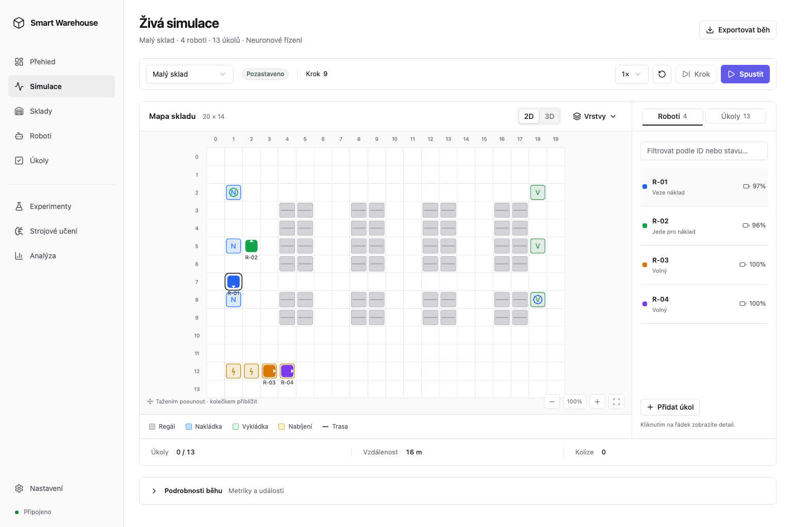
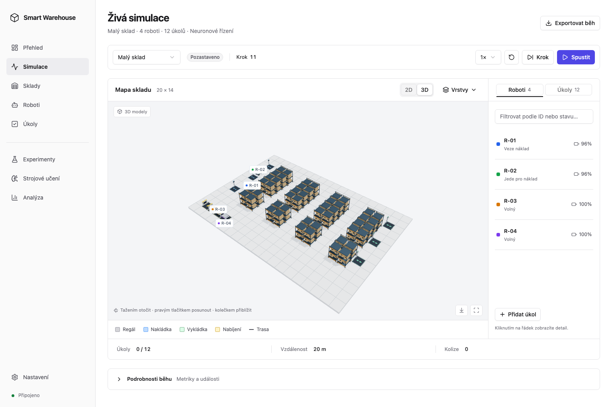

# Smart Warehouse AI

**Intelligent Multi-Robot Coordination System**

Vysokoškolský projekt: **Návrh a experimentální vyhodnocení inteligentního systému pro koordinaci autonomních robotů ve skladovém prostředí.**

Funkční lokální simulační a experimentální platforma s 2D a 3D zobrazením. Roboti přebírají přepravní úkoly, plánují trasy, nakládají a vykládají, vracejí se k nabíjení. Backend v Pythonu je jediným zdrojem stavu. PixiJS i Three.js zobrazují stejné skutečné snapshoty; frontend neobsahuje rozhodovací ani pohybovou logiku enginu. Aplikace nevyžaduje žádné AI API, placený účet nebo cloud.



## Rychlé spuštění — Docker

Požadavky: Docker Desktop / Docker Engine s Compose, volné porty 5173, 8000 a 55432.

```bash
cp .env.example .env
# Výchozí lokální heslo je pouze pro loopback vývoj.
docker compose up --build -d --wait
```

- Aplikace: [http://localhost:5173](http://localhost:5173)
- API a interaktivní OpenAPI: [http://localhost:8000/docs](http://localhost:8000/docs)
- Health včetně DB/migrace: [http://localhost:8000/api/health](http://localhost:8000/api/health)
- PostgreSQL: localhost:55432, databáze a uživatel `warehouse`.

Migrace se aplikují při startu backend kontejneru. Dashboard zpočátku obsahuje prázdný stav. Tlačítko **Vytvořit ukázkové scénáře** vytvoří tři skutečné uložené scénáře; nesimuluje výsledky. Pak otevřete **Malý sklad → Spustit**. Plánovač a přiřazování jsou pod **Nastavení** v liště simulace; vrstvy a dynamické překážky pod **Vrstvy**, detail robota po kliknutí a metriky pod **Podrobnosti běhu**. Všechny služby mají být provozované lokálně; nepoužívejte více backend workerů.

`docker compose stop` zastaví služby bez odstranění dat. Porty lze přepsat `API_PORT=18000 WEB_PORT=15173 docker compose up -d`; PostgreSQL zůstává 55432. `docker compose down` zachová pojmenovaný volume; `down -v` by trvale odstranilo lokální databázi.

## Vývoj bez kontejnerů aplikace

Požadavky: Python 3.12+, [uv](https://docs.astral.sh/uv/), Node 24 LTS (>=24.15, `.nvmrc`), npm, Docker jen pro PostgreSQL. Verze jsou uzamčené v `uv.lock` a `package-lock.json`. V tomto prostředí ověřeno na Pythonu 3.12.2 a Node 24.22.3.

```bash
nvm use # případně nejprve nvm install 24
make setup
make dev
```

`make dev` spustí PostgreSQL, aplikuje migrace a otevře backend 8000 + Vite 5173. Ctrl+C ukončí lokální aplikační procesy, PostgreSQL může zůstat běžet. Nespouštějte současně Docker frontend/backend a lokální aplikace na stejných portech.

Samostatné příkazy:

```bash
make db
make migrate
uv run --directory apps/backend uvicorn app.main:app --host 127.0.0.1 --port 8000
# v druhém terminálu
npm --prefix apps/frontend run dev
```

Vite a Nginx proxy `/api` a `/ws` na backend. `DATABASE_URL` lze nastavit jako proměnnou prostředí; `.env` slouží Compose. Pro lokální CLI mimo výchozí konfiguraci proměnnou explicitně exportujte.

## Implementované funkce

- Deterministický diskrétní tick engine; start/pause/resume/reset/stop/single-step, logický čas oddělený od real-time rychlosti.
- Skutečné A*, space-time A*, reservation table, prioritized planning, CBS a adaptivní prioritizované přeplánování. Žádný skrytý fallback z CBS.
- Nearest, priority-aware, vlastní obdélníkový Hungarian a ML scheduler; energie, nosnost, služba a základní charging policy.
- Skutečné strojové učení (Random Forest): data z dokončených jízd, odhad doby přepravy, výběr robota, verzované modely, validace na oddělených mapách a párové porovnání proti současným metodám.
- Seedovaný generátor průchozích skladů s nastavitelnými rozměry, regály, roboty, úkoly, úzkými průjezdy a přepravami v obou směrech; náhled lze dál upravit v editoru.
- Centrální kontrola vertex konfliktů, edge-swap, stěn, baterie a historie dokončených úkolů. Nebezpečný pohyb se neprovede.
- Přepínač 2D / 3D bez restartu běhu, prostorová kamera a osm vlastních Blender modelů: AMR, regál, nakládka, vykládka, nabíjení, náklad, stěna a překážka.
- PixiJS mapa s výběrem, zoom/pan, souřadnicemi, trasami, rezervacemi, konflikty, ID, stanicemi a heatmapou; vizuální interpolace.
- Editor buněk a robotů, změna vlastností, undo/redo, vytvoření rozměrů mapy, uložení/načtení scénáře, JSON import/export a serverová validace.
- Živá fronta úkolů, detail robota/úkolu, přidání úkolu a dynamické překážky, dostupnost idle robotů.
- REST + verzované WebSocket snapshoty, reconnect a ochrana před starými sekvencemi, obnovení aktuální session po reloadu.
- Headless experimenty A–F, porovnání plánovačů i schedulerů, limitované procesy, zrušení, reálné výsledky a CSV/JSON export, průměr/σ/úspěšnost.
- České rozhraní včetně formulářů, stavů, událostí a chybových hlášek; český zápis čísel a dat a vyhledávání bez diakritiky.
- Jednotné světlé shadcn/ui rozhraní, dashboard se seznamem scénářů, detail v bočním panelu, sbalovací metriky, záložky experimentů a mobilní navigace. Tabulky robotů/úkolů, časové grafy, využití flotily, baterie a heatmapa.
- PostgreSQL perzistence map/scénářů, konfigurací a výsledků; Alembic migrace, strukturované logování, Docker Compose.

## Neuronové řízení flotily

V **Strojové učení → Otevřít ukázkový sklad** spustíte simulaci, ve které neuronová síť vybírá úkoly, nabíječky a jednotlivé kroky robotů. Stejné řízení používají vlastní i vygenerované sklady. Simulátor vykonává povolené akce a kontroluje průchodnost, kolize a energii.

Síť se učí z vlastních jízd. Sbírá výsledky pohybů, dokončených přeprav a nabíjení i odmítnuté konfliktní návrhy. Každých 64 kroků s dostupnou zpětnou vazbou aktualizuje váhy a uloží je do PostgreSQL. Další kroky používají nově uložené váhy. Na stránce **Strojové učení** najdete verzi modelu, počet aktualizací a počet použitých zkušeností. V **Podrobnostech běhu** uvidíte zvolené akce a skóre.

Výchozí síť před průběžným učením dokončila 22 z 24 testovacích scénářů. Dva běhy se zastavily v úzkých průjezdech. [Trénink, archivní měření a reprodukce](docs/experiments/neural-fleet/report.md).

## Vlastní generované sklady

**Sklady → Generovat sklad** vytvoří reprodukovatelný náhled podle parametrů a seedu. Volby **Zúžené průjezdy** a **Oba směry** přidají 1–3 průjezdy šířky 1–3 buňky a protisměrné přepravy. Uložený sklad lze spustit ve 2D nebo 3D.

[Starší výzkum s odhadem doby přepravy](docs/machine-learning.md) popisuje archivní model Random Forest a výsledky měření.

## Přepínání 2D / 3D

V záhlaví mapy simulace zvolte **3D**. Tažením kameru otočíte, pravým tlačítkem posunete a kolečkem přiblížíte; dole jsou tlačítka pohledu shora a obnovy kamery. Kliknutím na robota nebo jeho ID otevřete stejný detail jako ve 2D. Přepnutí pohledu zachová aktuální běh, pauzu, úkoly i výběr.

Modely jsou již připojené přes `apps/frontend/public/models/manifest.json`. Editovatelný zdroj najdete v [warehouse-assets.blend](assets/blender/warehouse-assets.blend). Regály a stanice sdílejí instancovanou geometrii; roboti mají barvy flotily a zobrazují skutečný náklad. [Návod pro připojení](docs/future-3d.md) a [modely pro Blender](docs/blender-assets.md) popisují rozměry, pivoty i opakovaný export.



## Technologie

Frontend: React 19, strict TypeScript 7, Vite 8, Tailwind 4, shadcn/ui (Radix), Zustand, TanStack Query, React Router, PixiJS 8, Three.js, React Three Fiber, Drei, Recharts, Lucide, Zod, Vitest/RTL a Playwright. Backend: Python 3.12+, FastAPI, Pydantic 2, SQLAlchemy 2, Alembic, PostgreSQL 17, WebSockets, pytest, Ruff, mypy a uv. Strojové učení používá scikit-learn a NumPy; trénink běží v samostatném procesu.

## Testování

```bash
make test      # pytest + Vitest/React Testing Library
make check     # Ruff, strict mypy, strict TS a produkční Vite build
cd apps/frontend && npx playwright install chromium && cd ../..
make e2e       # Playwright; s běžící DB, servery případně spustí sám
```

Backend testy zahrnují malé MAPF případy, rezervace, budoucí constraints cíle, timeout, Hungarian proti exhaustive oracle, energii/nabíjení, seedové invarianty, celé přepravy, REST/DB a WebSocket. CBS je porovnán s nezávislým joint-state Dijkstra oracle na 24 malých problémech. E2E ověřuje dashboard → skutečný pohyb → pause → nový úkol → experiment → měřené výsledky/CSV; navíc editor a mobilní viewport. Detailní evidence je v [QA reportu](docs/QA_REPORT.md).

Integrační unit testy používají izolované SQLite soubory; reálné PostgreSQL migrace a kompletní Docker deployment se ověřují samostatně. Testy nevytvářejí předstírané produkční metriky. E2E ukládá vlastní scénář a výsledky do lokální vývojové DB.

## Scénáře a experimentální workflow

`scenarios/small.json` (20×14, 4 roboti, 12 úkolů), `medium.json` (28×20, 6, 24), `large.json` (40×28, 10, 40). Regály mají průchozí uličky a příčný průchod, pickup vlevo, dropoff vpravo, domácí chargery dole. Importujte přes **Sklady → Importovat JSON → Uložit scénář**.

V **Experimentech** vyberte mapu, statický MAPF nebo průběžnou přepravu, testovací scénář, plánovače, přiřazování, počet robotů/úkolů, seed a limity. Stavy výsledků se zobrazují česky (například Úspěch, Konflikt, Plán nenalezen, Časový limit); exporty zachovávají původní technické identifikátory. Časový limit není důkaz neřešitelnosti. Při zrušení se nezahájí další běh, současný doběhne do limitu.

Bez UI, API nebo databáze:

```bash
make benchmark
uv run --directory apps/backend python -m app.experiments.cli \
  --scenario ../../scenarios/small.json \
  --config ../../scenarios/benchmarks/F-task-scheduling.json \
  --output ../../docs/experiments/benchmark-F.json
```

Skutečné výchozí výsledky jsou v `docs/experiments/benchmark-*.json` a jejich interpretace v [results.md](docs/experiments/results.md). Nezaměňujte static MAPF Sum of Costs s transportními pohyby/čekáním nebo časem celé flotily.

## Dokumentace

- [Architektura, modely a protokol](docs/architecture.md)
- [Algoritmy, pseudokód, složitost a záruky](docs/algorithms.md)
- [Výzkumná metodika a definice metrik](docs/methodology.md)
- [Strojové učení, generátor a naměřené porovnání](docs/machine-learning.md)
- [2D / 3D renderer a připojení GLB](docs/future-3d.md)
- [Zadání modelů pro Blender](docs/blender-assets.md)
- [Osnova obhajoby na 12–15 minut](docs/presentation-outline.md)
- [Implementační etapy a stav](IMPLEMENTATION_PLAN.md)
- [Původní zadání](docs/REQUEST.md)

## Omezení a interpretace

Bodoví roboti, jeden přesun za tick, bez fyzikálního modelu a senzorové nejistoty. 3D zobrazuje tutéž rovinnou simulaci s modely z Blenderu; animace jednotlivých částí (otáčení kol, zdvih) zatím není zapojená. Station admission a návrat domů jsou konzervativní; mohou omezit paralelismus. Prioritizované plánování není úplné ani optimální. CBS optimalizuje statický MAPF SoC při úspěšném dokončení hledání; online přeprava nemá globální garanci. Velký konfliktní CBS problém může vyčerpat rozpočet a korektně selhat. Zablokování se řeší globálním přeplánováním nebo explicitním zastavením, ne univerzálním deadlock recovery.

Energetický odhad používá nejkratší vzdálenosti a rezervu; neznámé objížďky a čekání mohou vést k bezpečnému zastavení kvůli baterii. Kapacita scénáře: 64×64, 32 robotů, 500 úkolů; benchmark 1–16 robotů a nejvýše 120 runů. Snapshot historie je omezená; kompletní tick trace se neukládá do DB. Aktivní session se po restartu nezachovají. V1 nemá login a není připravená na přímé vystavení do veřejné sítě.
