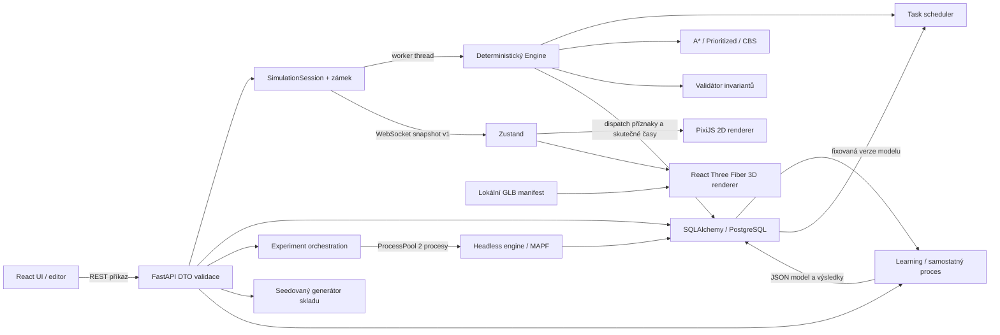

# Architektura

Projekt je lokální experimentální platforma: Python je jediným vlastníkem simulačního stavu. React nikdy nerozhoduje o pohybu. PixiJS a 3D renderer interpolují mezi přijatými celočíselnými pozicemi; po pauze i obnovení připojení zůstává autoritou snapshot serveru.



## Vrstvy a modely

- `domain/models.py`: explicitní Pydantic doména se schématem v1, roboty, úkoly, stavem a metrikami. Objekty jsou mutable pouze v enginu pod zámkem orchestrace. `schemas/requests.py` odděluje příkazová DTO od domény. Použití Pydantic i v doméně je záměrná úspora dvojích datových modelů, nikoli závislost na API.
- `domain/grid.py`: průchodnost, deterministicky uspořádaní sousedé, BFS vzdálenosti.
- `algorithms`: čisté plánovací funkce bez sítě a databáze; explicitní status a důvod selhání.
- `scheduling`: energie, nosnost a samostatné přiřazování úkolů, včetně obdélníkového Hungarian algoritmu.
- `simulation/engine.py`: logický tick, manipulace, nabíjení, dispatch a události. `invariants.py` centrálně odmítá kolize a neplatný pohyb.
- `simulation/service.py`: životní cyklus, sekvence, real-time pacing a per-session `asyncio.Lock`. CPU plánování běží přes `asyncio.to_thread`, ne přímo v event loop. Python GIL může stále ovlivnit latenci; pro větší současné flotily lze přesunout celé session do procesů.
- `experiments`: izolované procesy a čistý CLI runner, průběžná perzistence výsledků.
- `persistence`: SQLAlchemy tabulka `documents(kind,id,payload,updated_at)`, verzované JSON dokumenty; schéma spravuje Alembic. PostgreSQL v produkční lokální konfiguraci, SQLite pouze pro izolované integrační testy.
- Frontend: TanStack Query pro perzistentní zdroje, Zustand pro poslední snapshot a preference, Zod pro snapshoty/import, React Router pro sekce. Renderer dostává `SceneFrame`; vizuální assety nejsou součástí domény.

## Zobrazovací adaptéry

`WarehouseViewport` vybírá 2D nebo lazy 3D renderer podle uložené preference. Oba dostávají stejný `SceneFrame` a callbacky pro výběr robota a úpravu překážek. Přepnutí neprovádí žádnou mutaci API. 3D transformace, kamera a interpolace jsou ve vykreslovací vrstvě, logický tick ani naměřené metriky nemění.

`public/models/manifest.json` přiřazuje druhům objektů lokální GLB. Základní tvary fungují bez modelových souborů; chyby manifestu/modelu jsou viditelné a neblokují simulaci. Ztráta WebGL nabídne návrat na 2D. Podrobnosti a exportní smlouva jsou v [3D dokumentaci](future-3d.md).

## Souřadnice a kontrakt

Počátek je vlevo nahoře; x doprava, y dolů. Logická buňka `(x,y)` má rozměr `cell_size` metrů. 3D střed buňky je `((x+.5)*cell_size,0,(y+.5)*cell_size)`. Orientace je úhel ve stupních, 0 = vpravo, 90 = dolů. Robot zabírá jednu buňku, přesun mezi sousedy trvá jeden tick. Diagonály a souběžné prohození hran nejsou povoleny.

`Warehouse.cells` je řídký seznam; neuvedená buňka je FLOOR. SHELF/WALL/OBSTACLE jsou neprůchozí. PICKUP/DROPOFF/CHARGER jsou průchozí funkční stanice. Nové úkoly vyžadují správné typy stanic. Každý snapshot nese `schema_version:1` a kompletní konfiguraci pro interpretaci metrik.

## Životní cyklus

`POST /simulations` vytvoří READY. Start nastaví RUNNING, pause PAUSED, step provede jeden krok z READY/PAUSED. V RUNNING není step povolen. Dokončení všech necanceled úkolů nastaví COMPLETED. Chyba plánování nastaví FAILED před nebezpečným pohybem. Reset obnoví výchozí scénář (včetně odstranění online přidaných úkolů/překážek), ale zachová rostoucí sequence. Stop nastaví STOPPED. Terminální běh se uloží do DB. Nový úkol lze přidat i k dokončenému běhu; ten pokračuje z PAUSED.

Aktivní simulace po restartu backendu zaniknou. Načtení starého ID vrátí 404 a klient zapomenutou relaci vymaže. Při otevírání nového běhu může klient poslat `replace_id`. Server připraví nový běh před ukončením předchozího a dovolí tuto výměnu i při limitu osmi relací. Zaniklé `replace_id` vytvoření nebrání. Odstranění již zaniklé relace vrátí 204. Experimenty nalezené po startu jako RUNNING se označí INTERRUPTED. Aplikaci provozujte s jedním Uvicorn workerem. Dokončený snapshot stejné relace se při dalším dokončení přepíše. Pro nezávislý záznam založte nový běh nebo experiment.

## WebSocket v1

```json
{"version":1,"type":"STATE_SNAPSHOT","sequence":12,"state":{"schema_version":1,"id":"…","sequence":12,"tick":8}}
```

Ukázka je zkrácená; plné schéma je `types/domain.ts` a OpenAPI. Každý REST příkaz a tick publikuje rostoucí sequence. Klient odmítá starší zprávy stejné session; sekvence resetem neklesá. Připojení okamžitě dostane aktuální snapshot, poté změny. Frontend obnovuje spojení s exponenciálním zpožděním 1–10 s a po reloadu načte ID session ze sessionStorage. Pomalý odběratel drží nejvýše jeden nejnovější snapshot. Odpojení klienta neruší engine. Události TASK_CREATED/ASSIGNED/COMPLETED, PATH_REPLANNED, OBSTACLE_ADDED/REMOVED, SIMULATION_* jsou součástí snapshotu; separátní delta zprávy se nepoužívají.

Při odstranění nebo nenalezení relace server zavře WebSocket kódem 4404. Klient vymaže zaniklý běh z obrazovky a zastaví další pokusy o spojení k tomuto ID.

Události jsou omezené na posledních 500, grafická historie na 5 000 ticků a vizualizace rezervací na příštích 16 kroků. Plánovač používá plné vlastní rezervace. Tyto tři struktury mají odlišný účel.

## Bezpečnost a dostupnost

Před přechodem se validují všechny navržené pozice i energie celé flotily; až potom se změní stav. Servisující, nabíjející a offline roboti jsou při plánování pevné překážky. Souběžné REST mutace, tick a snapshot chrání stejný zámek. Statické kolize v A* baseline znamenají CONFLICT, nikoli provedení kolize. Timeout není důkaz nemožnosti.

Lokální deployment nemá autentizaci a je určen k jednouživatelskému použití. Docker publikuje služby na loopback. Pro veřejný deployment je nutná autentizace, autorizace, TLS, omezení požadavků a externí správa session. Chyby DB vracejí konzistentní 503; vstupy 422; nenalezené zdroje 404. Strukturované JSON logy obsahují cestu, metodu a stav, ne plné payloady.

## Učení z přeprav

`learning/features.py` zachycuje příznaky při rozhodnutí, `model.py` trénuje Random Forest a provádí přenosnou JSON inferenci, `runner.py` používá stejný Engine pro sběr a párové porovnání. `learning/service.py` spravuje jednu práci v samostatném procesu a verzované JSON záznamy v existující tabulce dokumentů; databázové schéma se nemění.

Příznaky v2 mají 27 hodnot včetně obsazení deterministické BFS trasy a známých plánů ostatních robotů do 64 kroků. Před dávkou přiřazení se zachytí společný stav. Nový trénink filtruje verzi dat; staré epizody zůstávají archivované a modely v1 stále fungují nad původními 16 vstupy. Generátor v2 ukládá do metadat nastavení průjezdů a směru přeprav. Stejný scénář i snapshoty se zobrazují ve 2D/3D, fyzikální ani pohybová pravidla se kvůli zúžení nemění.

Session ukládá průběžně jednu aktualizovanou epizodu, reset získá nové ID. Nedokončená přidělení se evidují bez falešných štítků. `AlgorithmConfig.ml_model_id` fixuje model při vzniku simulace; snapshot obsahuje posledních 20 rozhodnutí s predikcemi přípustných kandidátů. Přetrénování aktivuje novou verzi jen pro nové simulace. Chybějící model vrací explicitní chybu a nikdy nepřepíná potichu na heuristiku. [Podrobnosti a limity](machine-learning.md).
