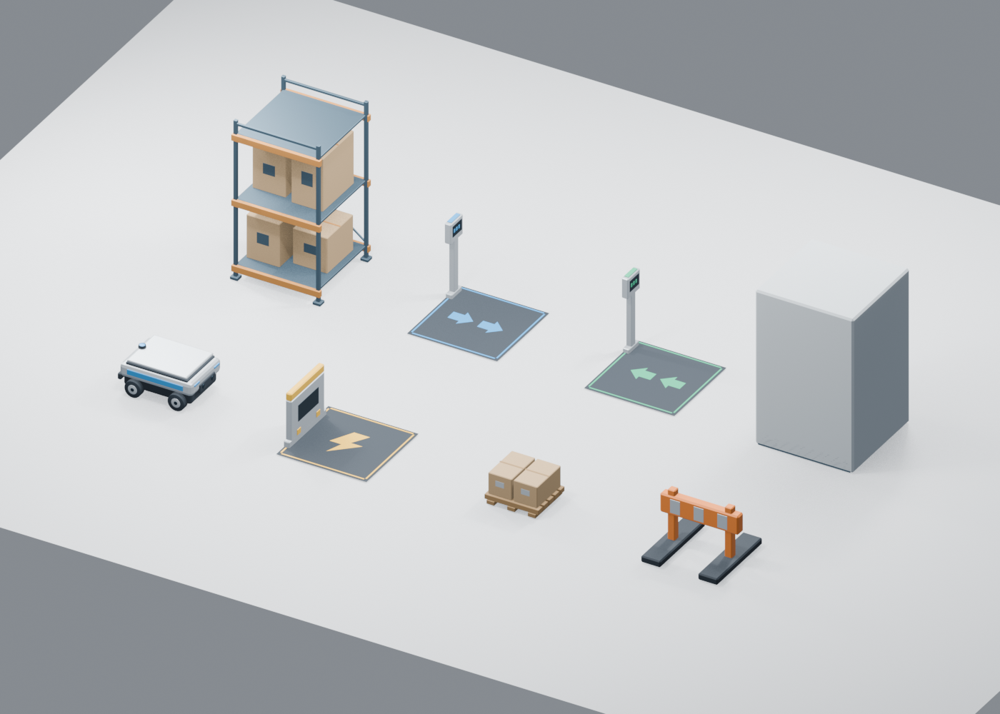

# Modely skladu v Blenderu

Cíl: jednotná sada stylizovaných průmyslových modelů pro přehledný sklad v izometrickém 3D pohledu. Světle šedý kov, tmavý podvozek, umírněné barevné detaily; čitelná silueta i při oddálení. Regály mají otevřené boky, aby nebyly roboti v uličkách zbytečně zakrytí. Bez popisků, čísel robotů, tras a UI zapečených do modelů.

## Dodaná sada

Všech osm modelů je vytvořených v Blenderu a připojených v aplikaci. Editovatelný zdroj: [warehouse-assets.blend](../assets/blender/warehouse-assets.blend), scéna **Warehouse · Asset Studio**. Zdroj obsahuje pojmenované části a nedestruktivní modifikátory; přehledové rozmístění modelů se při exportu odstraní. Původní scéna v Blenderu zůstala zachovaná. Modely jsou původní geometrie vytvořená pro tento projekt, bez převzatých assetů a externích textur.



| Model | Trojúhelníky | Materiály | GLB velikost |
|---|---:|---:|---:|
| Robot AMR | 6 016 | 4 | 170,3 KiB |
| Regál | 1 196 | 3 | 70,5 KiB |
| Nakládka | 358 | 4 | 23,1 KiB |
| Vykládka | 358 | 4 | 23,2 KiB |
| Nabíjení | 361 | 4 | 23,0 KiB |
| Paleta s nákladem | 488 | 3 | 30,3 KiB |
| Stěna | 132 | 2 | 9,4 KiB |
| Překážka | 484 | 3 | 30,3 KiB |

Celkem **389 292 B (380,2 KiB)**. Exporty obsahují jen geometrii a PBR materiály. Optimalizace `dedup` a `prune` nepoužívá kompresní dekodéry. Všech osm GLB prošlo validátorem bez chyb i varování a zpětným importem do Blenderu s tolerancí rozměrů 0,1 mm. Přesná evidence: [asset-report.json](../assets/blender/asset-report.json) a [blender-bounds.json](../assets/blender/blender-bounds.json).

## Úprava a opakovaný export

Otevřete dodaný `.blend`, upravte příslušnou kolekci `SW_AMR`, `SW_Shelf` atd. a uložte. V Python konzoli Blenderu načtěte [build_assets.py](../assets/blender/build_assets.py) s absolutní cestou vašeho checkoutu:

```python
import runpy
api = runpy.run_path('/cesta/smart-warehouse-ai/assets/blender/build_assets.py')
api['resume']()
api['export_asset']('robot')  # nebo shelf, pickup, dropoff, charger, pallet, wall, obstacle
# Pro export celé upravené sady:
for key in ('robot', 'shelf', 'pickup', 'dropoff', 'charger', 'pallet', 'wall', 'obstacle'):
    api['export_asset'](key)
```

Pak v terminálu v kořeni projektu spusťte `python3 scripts/optimize-models.py` s Node 24 / npm v PATH. Skript používá připnutý `@gltf-transform/cli@4.5.1`, při prvním použití jej npm stáhne. Po optimalizaci lze v Blenderu spustit `api['verify_exports']()`; nakonec obnovte stránku aplikace. Pro vytvoření sady od začátku v novém Blender souboru použijte `api['build_all']()` místo `resume`; existující asset studio tento příkaz odmítne přepsat.

Robot má čtyři samostatné uzly kol s pivoty v ose. Export těla slučuje geometrii podle materiálů. Materiál **SW_FleetAccent** zachovejte pod tímto názvem: aplikace jeho barvu přizpůsobuje jednotlivým robotům, ostatní materiály a geometrii sdílí. Statické modely renderer instancuje, takže množství regálů nenásobí počet jejich vykreslovacích volání.

## Seznam a rozměry

Rozměry jsou doporučené obálky **délka X × šířka Y v Blenderu × výška Z v Blenderu**, pro referenční buňku 1 m. Po GLB exportu je výška Y a druhý rozměr Z. Modely se ve skladu rovnoměrně škálují velikostí buňky.

| Klíč manifestu | Soubor v `public/models/` | Rozměry | Co vymodelovat |
|---|---|---|---|
| `robot` | `robots/amr.glb` | 0,78 × 0,58 × 0,38 m | AMR podvozek, kola, horní plošina, přední senzor, jednoduché světlo; bez palety |
| `shelf` | `warehouse/shelf.glb` | 0,92 × 0,92 × 1,65 m | Jeden modul regálu, stojiny, tři police, přiměřené množství krabic; moduly vedle sebe tvoří řadu |
| `pickup` | `warehouse/pickup.glb` | 0,92 × 0,92 × 0,8 m | Modře označené místo nakládky, podlahová plocha a boční terminál |
| `dropoff` | `warehouse/dropoff.glb` | 0,92 × 0,92 × 0,8 m | Zelené místo vykládky, stejná konstrukční řada jako nakládka |
| `charger` | `warehouse/charger.glb` | 0,92 × 0,92 × 0,55 m | Žluté dokovací místo, boční nabíjecí jednotka a kontakty |
| `pallet` | `warehouse/pallet.glb` | 0,55 × 0,48 × 0,32 m | Paleta s nákladem, samostatný objekt pokládaný na robota |
| `wall` | `warehouse/wall.glb` | 1 × 1 × 1,6 m | Modul neprůchozí stěny; odpovídá celé blokované buňce |
| `obstacle` | `warehouse/obstacle.glb` | 0,8 × 0,8 × 0,6 m | Jasně rozpoznatelná oranžová bariéra nebo uzavřená přepravka |

Podlaha, mřížka, trasy, rezervace, obrysy výběru a popisky vznikají v rendereru. V této fázi je není potřeba modelovat. Samostatný dopravník je volitelné pozdější rozšíření; současné stanice zajišťují nakládku/vykládku podle enginu.

Stanice jsou **průjezdné**: centrální pás pro robota musí zůstat volný. Terminál patří k okraji buňky; neveďte pevnou konstrukci přes střed. Regál a stěna jsou neprůchozí. Model nemá přesahovat do sousední uličky.

## Společná pravidla

1. Blender Units: Metric, Unit Scale 1, délky v metrech. Modelujte referenční buňku 1 × 1 m.
2. Origin kořenového objektu: `(0,0,0)` u podlahy ve středu půdorysu. Geometrie nesmí být pod podlahou. Root má nulovou pozici/rotaci a jednotkové měřítko.
3. Robot míří dopředu po **+X** už v Blenderu. Z je v Blenderu nahoru; běžný glTF export s +Y Up převede souřadnice pro Three.js. Neotáčejte model dodatečně o 90° v kódu.
4. Používejte jeden kořen `AMR`, `Shelf`, `Pickup`, `Dropoff`, `Charger`, `Pallet`, `Wall` nebo `Obstacle` (export přidává příponu `_Root`). Jeho children pojmenujte srozumitelně (`Body`, `Deck`, `Wheel_FL`, `Wheel_FR`, `Wheel_RL`, `Wheel_RR`, `StatusLight`). Názvy jsou příprava pro pozdější animace, aktuální renderer je nevyžaduje.
5. Aplikujte Rotation & Scale na statické části, zkontrolujte normály, odstraňte skryté duplikáty. Budoucím kolům ponechte pivot v ose otáčení. Robota neduplikujte pro každé ID: runtime používá jeden model opakovaně a rozlišení zajišťují popisky/výběr.
6. Paleta má vlastní origin u spodní kontaktní plochy. Renderer ji umisťuje na výšku **0,35 m** nad originem robota; horní nosná plocha robota má této výšce odpovídat. Pokud se změní konstrukční rozměr, upravte montážní výšku v rendereru i tuto smlouvu společně.
7. Principled BSDF / PBR, minimum materiálů a především sdílené textury. Začněte 1K PNG/JPEG, větší rozlišení pouze pro prokazatelný vizuální přínos. Žádné externí fonty, HDRI nebo placené závislosti pro základní funkci.

## Orientační rozpočet

- Robot: do 10 tisíc trojúhelníků, ideálně 2–4 materiály.
- Opakovaný regál: do 2 tisíc trojúhelníků, 2–3 materiály.
- Stanice: do 3 tisíc trojúhelníků, 2–4 materiály.
- Paleta / překážka / stěna: přibližně do 1 tisíce trojúhelníků.
- Celá první sada: cílit na méně než 10 MB; jde o pracovní rozpočet, ověřit na reálných modelech a scéně.

Detaily používejte tam, kde budou z běžné kamery vidět. Šrouby, kabely a drobné drážky lze řešit texturou. Nestačí malé soubory: počet meshů a materiálů ovlivňuje počet draw calls. Po prvním ověření lze použít [glTF Transform](https://gltf-transform.dev/) pro prune/dedup a další optimalizace; komprese musí odpovídat zapojenému loaderu.

## Export a převzetí

1. Uložte editovatelný zdroj například do `assets/blender/warehouse-assets.blend`.
2. Vyberte kořen a všechny související části jednoho modelu. File → Export → glTF 2.0, formát **GLB**, Selection Only, +Y Up, materiály a textury uvnitř souboru.
3. Neexportujte kameru, světla ani celou demonstrační scénu. Pro první sadu vypněte animace i kompresi Draco. Modifikátory ověřte na výsledném exportu.
4. Znovu importujte GLB do čisté testovací scény: správné rozměry, pivot, směr +X, materiály, žádné chybějící textury.
5. Přesuňte soubor do `apps/frontend/public/models/...` a připojte ho v [manifestu](../apps/frontend/public/models/manifest.json). Přesný postup je v [návodu pro 3D](future-3d.md).
6. Ve skutečné aplikaci zkontrolujte roboty ve čtyřech směrech, průjezd stanicí, náklad na plošině, barvy v osvětlení aplikace, výběr, pauzu a reset. Zkontrolujte i velký sklad a mobil.

Budoucí klipy `Idle`, `Drive`, `Load`, `Unload`, `Charge` mohou animovat části modelu, ale nesmí posouvat root robota. Jejich přehrávání zatím není zapojené. Skutečnou trasu, rychlost kroků, obsazení buněk, baterii a dokončení úkolů vždy určuje backend.
