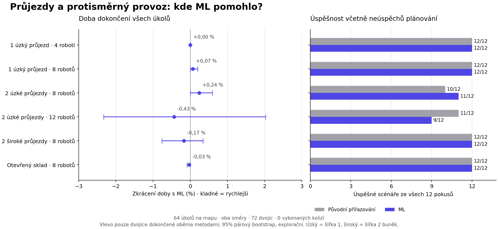

# ML při úzkých průjezdech a protisměrném provozu

Vyhodnocení dokončeno 14. 11. 2026; časové značky surových běhů jsou v UTC. **Nový model už mění přiřazování robotů, ale obecný provozní přínos se neprokázal.** V úzkých průjezdech s 8 roboty pomohl v několika případech. S 12 roboty častěji skončil neúspěchem plánování. Celkem dokončilo původní řešení 69/72 scénářů, ML 68/72. V 67 dvojicích, kde dokončily obě metody, ML 5× vyhrálo, 54× remizovalo a 8× prohrálo; souhrnná doba byla o 0,027 % horší. Tento průměr je jen popis směsi podmínek, ne hlavní odhad účinku.

## Co se změnilo

Generátor v2 umí 1–3 průjezdy šířky 1–3 buňky. Dvě buňky silná středová stěna sahá od horního po spodní okraj; mezi oběma částmi se tedy nedá projet mimo průjezdy. Polohy průjezdů určuje seed, prostor podél stěny zůstává průchozí. Volba **Oba směry** přidává nakládky a vykládky na obě strany; polovina ze 64 úkolů vede proti druhé polovině. Domovy robotů jsou rozdělené mezi obě strany. BFS kontroluje souvislost všech průchozích buněk. Příliš mnoho širokých průjezdů pro malou mapu se odmítne s vysvětlením.

Model používá **27 vstupů (verze 2)**: původních 16 plus 11 údajů o konkrétní kandidátní trase — obsazení cest k nakládce a vykládce, stojící roboti, překryv známých plánů, nominální vertex/edge-swap konflikty, souběžné a protisměrné úseky, úzké buňky a jejich obsazení, zbývající obsluha na cestě. Geometrická trasa je deterministická BFS cesta; časové konflikty používají nejvýše 64 kroků **aktuálně známých** plánů. Pozdější přepočítání tras ani skutečný budoucí čas do vstupů nevstupují. Jde o indikátory možného zdržení, nikoli předpověď skutečné kolize nebo přesnou budoucí trasu.

Starých 9 036 záznamů verze 1 zůstává archivovaných; chybějící příznaky tras se zpětně nevymýšlejí. Starší modely lze dál použít s jejich původními 16 vstupy. Nový trénink využívá pouze kompatibilní pozorování v2. Pohyb, admission policy, nabíjení, plánovač a kontrola kolizí zůstávají stejné pro obě metody.

## Předem stanovený experiment

[Plán](plan.json) byl uložen před sběrem a porovnáním. Šest podmínek z tabulky níže, každá s 15 tréninkovými mapami: **90 pokusů**, 64 úkolů na mapu, oba směry. Seedy 610000–610014, 620000–620014, 630000–630014, 640000–640014, 650000–650014, 660000–660014. Střídají se uličky, ostrůvky a smíšené regály, rozměry 16/20/24 × 18/20/22 a požadované hustoty 12/22/32 %. Sběr střídá nearest/priority/Hungarian. Parametry Random Forest zůstaly 96 stromů, hloubka 12, minimum 3 vzorků v listu.

Dokončilo 87/90 tréninkových map. Získáno 5602 skutečně dokončených přeprav. Se stávajícími 88 kompatibilními pozorováními má model **5690 štítků / 95 rozložení**. Jedna neúspěšná mapa nedodala žádný štítek, proto se nepočítá do map modelu, ale zůstává mezi 90 pokusy. Trénink: 4202 přeprav / 71 map; holdout: 1488 / 24 jiných map. Dokončené jízdy z částečně neúspěšných běhů zůstávají v datech; nedokončené nemají regresní štítek.

Poté **72 dvojic / 144 simulací**: 12 pro každou podmínku, seedy 750000–750011. Všechny testovací mapy jsou mimo trénink i validační holdout. Stejné seedy mezi podmínkami vytvářejí příbuzné geometrie; 72 případů nepovažujeme za 72 nezávislých náhodných geometrií. Referencí je dosavadní `priority`, obě větve používají `adaptive` a identický kompletní počáteční scénář. Limit je 4 000 kroků / 30 s. Model `cea34362-b596-4ff3-bb4c-0b380e7bdbdf` byl zmrazený před testy, testovací epizody se neukládají do tréninku. Dataset byl před i po evaluaci shodný; po výsledcích nebyl model laděn na testovacích mapách.

## Výsledky na nových mapách

Kladné procento znamená rychlejší ML. Časy a výhry/remízy/prohry se počítají jen z dvojic, kde dokončily obě metody; úspěšnost ze všech 12 pokusů v každé podmínce. **Ve všech 144 testovacích simulacích bylo nula vykonaných kolizí.**

| Podmínka | Úspěch původní · ML | Úspěšných dvojic | Původní (kroky) | ML (kroky) | Zkrácení ML | 95% bootstrap interval | Výhry / remízy / prohry |
|---|---|---:|---:|---:|---:|---|---|
| 1 průjezd šířky 1 · 4 roboti | 12/12 · 12/12 | 12 | 1 322,7 | 1 322,7 | 0,00 % | 0,00 až 0,00 % | 0 / 12 / 0 |
| 1 průjezd šířky 1 · 8 robotů | 12/12 · 12/12 | 12 | 734,1 | 733,6 | 0,07 % | 0,00 až 0,20 % | 1 / 11 / 0 |
| 2 průjezdy šířky 1 · 8 robotů | 10/12 · 11/12 | 10 | 670,3 | 668,7 | 0,24 % | 0,00 až 0,59 % | 2 / 8 / 0 |
| 2 průjezdy šířky 1 · 12 robotů | 11/12 · 9/12 | 9 | 540,0 | 542,3 | -0,43 % | -2,33 až 2,03 % | 1 / 3 / 5 |
| 2 průjezdy šířky 2 · 8 robotů | 12/12 · 12/12 | 12 | 635,2 | 636,2 | -0,17 % | -0,76 až 0,34 % | 1 / 9 / 2 |
| Otevřený sklad · 8 robotů | 12/12 · 12/12 | 12 | 608,2 | 608,4 | -0,03 % | -0,08 až 0,00 % | 0 / 11 / 1 |



Intervaly: 10 000 párových bootstrap výběrů uvnitř podmínky, seed 20261113, percentily 2,5/97,5 %. Explorační, bez korekce na více porovnání, podmíněné společným dokončením. Všechny intervaly zahrnují nulu; malý vzorek ani interval 0–0 nedokazují shodné chování na budoucích mapách. Výpočetní čas je uložený, ale vždy se běželo původní → ML a nešlo o řízený CPU benchmark.

**Konkrétní přínos:** u 8 robotů a dvou úzkých průjezdů (seed 750010) původní plánování selhalo po 8 úkolech; ML dokončilo všech 64. Nejlepší společně dokončený případ: 2 průjezdy šířky 1 · 12 robotů, seed 750006, 452 → 411 kroků, tedy o 9,1 % rychleji.

**Konkrétní zhoršení:** u 12 robotů a dvou úzkých průjezdů ML navíc selhalo na seedech 750000 a 750009, které původní řešení dokončilo. Nejhorší společně dokončený případ: seed 750011, 552 → 580 kroků, o 5,1 % pomaleji. Výhodné příklady proto neznamenají spolehlivou převahu modelu.

## Všechny neúspěchy

Ve všech uvedených selháních plánovač vrátil `adaptive: NO_PLAN. Priority order or horizon prevents a plan`. Prioritizované/adaptivní plánování není úplné; neúspěch není důkazem neexistence řešení. Nebyl použit skrytý náhradní plánovač. Kratší čas neúspěšného běhu se nikdy nepočítá jako zrychlení.

| Podmínka | Seed | Původní (dokončené úkoly) | ML (dokončené úkoly) |
|---|---:|---|---|
| 2 průjezdy šířky 1 · 8 robotů | 750009 | FAILED (21/64) | FAILED (21/64) |
| 2 průjezdy šířky 1 · 8 robotů | 750010 | FAILED (8/64) | COMPLETED (64/64) |
| 2 průjezdy šířky 1 · 12 robotů | 750000 | COMPLETED (64/64) | FAILED (1/64) |
| 2 průjezdy šířky 1 · 12 robotů | 750002 | FAILED (43/64) | FAILED (43/64) |
| 2 průjezdy šířky 1 · 12 robotů | 750009 | COMPLETED (64/64) | FAILED (8/64) |

Neúspěšné tréninkové běhy: seed 620009 (0/64 úkolů), seed 640002 (12/64 úkolů), seed 640004 (22/64 úkolů). Všechny mají stejný důvod `NO_PLAN`.

## Predikce a skutečná zdržení

| Holdout, logické kroky | ML | Geometrický základ |
|---|---:|---:|
| MAE | 1,9991 | 1,7876 |
| RMSE | 2,9852 | 3,5848 |

ML má horší průměrnou absolutní chybu, ale nižší RMSE, které více penalizuje velké chyby. Oproti předchozí studii se změnila distribuce map i vstupy; její MAE nelze přímo srovnat s touto. Nebyla provedena ablace se stejnými daty a odstraněnými příznaky tras, takže jejich samostatný kauzální přínos z tohoto experimentu nevyvozujeme.

V nových datech mělo zdržení nad BFS+obsluhou 2182/5602 přeprav (39,0 %). Zdržení zahrnuje čekání i objížďky; nejde o totožnou metriku jako celkové čekání všech robotů.

| Tréninková podmínka | Dokončených přeprav | Podíl se zpožděním | Průměr zpoždění (kroky) | Maximum |
|---|---:|---:|---:|---:|
| 1 průjezd šířky 1 · 4 roboti | 960 | 31,1 % | 1,142 | 13 |
| 1 průjezd šířky 1 · 8 robotů | 896 | 58,4 % | 3,294 | 25 |
| 2 průjezdy šířky 1 · 8 robotů | 960 | 39,4 % | 1,529 | 15 |
| 2 průjezdy šířky 1 · 12 robotů | 866 | 55,2 % | 2,443 | 24 |
| 2 průjezdy šířky 2 · 8 robotů | 960 | 29,9 % | 0,661 | 7 |
| Otevřený sklad · 8 robotů | 960 | 22,6 % | 0,459 | 5 |

Interpretace: přidané průjezdy vytvářejí měřitelná zdržení a nové vstupy ovlivňují naučené stromy. Minimalizace času jedné přepravy však nemusí minimalizovat dokončení celého skladu ani udržet řešitelnost dalších plánů. Konzervativní rezervace stanic, návraty domů, znalost pouze současných plánů, BFS výběr jedné z možných cest a chybějící štítky neúspěšných přeprav omezují model. Pro běžné použití zůstává původní přiřazování rozumnou výchozí volbou; ML je volitelný experimentální scheduler. Další výzkum by měl samostatně měřit riziko selhání a delší dopad přiřazení, s novými testovacími seedy.

## Aplikace, evidence a reprodukce

**Sklady → Generovat sklad → Zúžené průjezdy / Oba směry**. Nastavit lze počet a šířku průjezdů. Stejné volby jsou ve **Strojové učení** pro sběr i nové porovnání. **Porovnání → Uložené porovnání** obsahuje šest výsledků označených flotilou, počtem/šířkou průjezdů a směrem. Aktivní model je `cea34362`; původní scheduler zůstává dostupný. Záložka Model a trénink vysvětluje oddělení starých dat. Podrobnosti živé ML simulace ukazují obsazení úseků a protisměrné úseky; obsazení je součet obou částí cesty, takže stejný robot se může započítat v obou.

- [Souhrn JSON](summary.json), [72 dvojic CSV](pairs.csv), [diagnostika](training-diagnostics.json), [reprodukovatelnost](reproducibility.json).
- Kompletní scénáře a běhy: [1 průjezd šířky 1 · 4 roboti](comparison-one-narrow-4.json), [1 průjezd šířky 1 · 8 robotů](comparison-one-narrow-8.json), [2 průjezdy šířky 1 · 8 robotů](comparison-two-narrow-8.json), [2 průjezdy šířky 1 · 12 robotů](comparison-two-narrow-12.json), [2 průjezdy šířky 2 · 8 robotů](comparison-two-wide-8.json), [Otevřený sklad · 8 robotů](comparison-open-8.json).
- [Model a všech 96 stromů](model.json), [přesná vstupní data modelu](training-episodes.json.gz), [všech 90 sběrových epizod včetně prázdného neúspěchu](study-episodes.json.gz). Hash dat odpovídá modelu. Starší studie a její artefakty zůstaly zachované.
- [Desktop](app-two-narrow-12.png), [mobil](app-mobile.png), [rozbalené neúspěchy](app-failures.png), [model](app-model.png), [graf SVG](comparison.svg), [ověření prohlížeče](browser-verification.json).

```bash
# Kořen projektu, běžící backend; existující adresář navazuje na uložené práce.
python3 scripts/ml-route-study.py
python3 scripts/analyze-ml-route-study.py
uv run --directory apps/backend python ../../scripts/freeze-ml-route-study.py
python3 scripts/plot-ml-route-study.py  # matplotlib a numpy
python3 scripts/report-ml-route-study.py
```

Skript freeze při existujícím archivu používá zmrazená data, znovu natrénuje model seedem 660000 a porovná stromy, metriky, split, importance a hash; nic neaktivuje ani nezapisuje do databáze. Přesná reprodukce všech těchto polí prošla. Ověřené hashe zdrojů a verze prostředí jsou v artefaktech. Nový `--output` pro sběrový skript spustí další studii; následné analýzy mají v souboru nastavený adresář této studie. Nový sběr může zahrnout další živé jízdy, takže není náhradou zmrazeného datasetu.

Backend byl při nasazení příznaků v2 restartován; předchozí dokončený uživatelský snapshot je zálohovaný v `.run/pre-route-learning-sessions.json`. Aktivní simulace jsou pouze v paměti. Schéma PostgreSQL se neměnilo.
