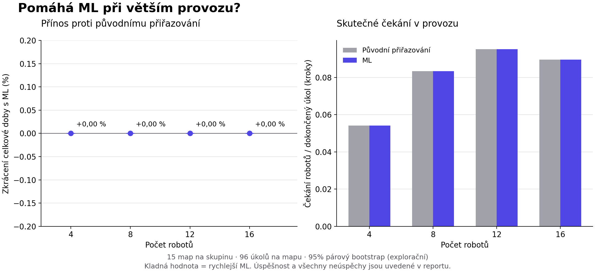

# Strojové učení při hustším provozu

Měření 13. 11. 2026. **Na žádné ze čtyř testovaných úrovní provozu ML nezměnilo přiřazení robotů ani nezkrátilo dokončení skladu. Více dat zlepšilo predikce proti předchozímu ML modelu, ale provozní přínos se neprokázal.**

## Předem určený experiment

Plán byl uložen před sběrem a porovnáním do [plan.json](plan.json). Algoritmy, příznaky, kapacity, nabíjení, admission policy ani plánovač se v průběhu neměnily; kontrola hashů zdrojů prošla. Referencí je dosavadní scheduler `priority`, plánovač je v obou větvích `adaptive`.

- 90 nových map: 30 s 8, 30 s 12 a 30 s 16 roboty. Každá má 96 úkolů; seedy 310000–310029, 320000–320029 a 330000–330029. Střídají se regálové uličky, ostrůvky a smíšené rozložení; rozměry 16/20/24 × 18/20/22. Požadované pokrytí regály 12/22/32 %, skutečné pokrytí omezuje prostor průchodů.
- Tréninkové simulace dokončily 90/90 map a přidaly 8640 skutečných přeprav. Se stávajícími daty má model 9036 vzorků z 109 map: 6880 / 81 map pro trénink a 2156 / 28 map pro validaci. Během sběru přibylo také 20 přeprav z běžné uživatelské simulace; jsou zahrnuté ve zmrazené sadě.
- Následuje 60 **dvojic** běhů, tedy 120 testovacích simulací: 15 pro každou flotilu 4/8/12/16. Každý scénář má 96 úkolů, seedy 450000–450014. Mezi velikostmi flotil jsou shodné regály, úkoly a počáteční konfigurace prvních čtyř robotů; přidávají se další roboti a jejich nabíječky. Jde o 15 příbuzných základních rozložení, nikoli 60 statisticky nezávislých geometrií.
- Obě metody používají identický kompletní scénář a limit 4 000 kroků / 30 s na běh. Model `439b6df4-eafa-4f98-a817-f7e68c001ac8` je zmrazený před testováním. Všechny testovací mapy jsou mimo jeho trénink i validaci. Testovací běhy dataset nezměnily.

## Skutečný provozní přínos

Kladné procento znamená kratší dokončení s ML. Průměry se počítají pouze z úspěšných dvojic, úspěšnost ze všech pokusů. Výhry/remízy/prohry jsou podle makespanu. Ve všech testovacích bězích bylo nula vykonaných kolizí.

| Robotů | Úspěch původní · ML | Původní (kroky) | ML (kroky) | Zkrácení s ML | 95% bootstrap interval | Výhry / remízy / prohry ML |
|---|---|---:|---:|---:|---|---|
| 4 | 15/15 · 15/15 | 1 695,7 | 1 695,7 | 0,00 % | 0,00 až 0,00 % | 0 / 15 / 0 |
| 8 | 15/15 · 15/15 | 1 127,0 | 1 127,0 | 0,00 % | 0,00 až 0,00 % | 0 / 15 / 0 |
| 12 | 15/15 · 15/15 | 1 058,6 | 1 058,6 | 0,00 % | 0,00 až 0,00 % | 0 / 15 / 0 |
| 16 | 15/15 · 15/15 | 1 029,1 | 1 029,1 | 0,00 % | 0,00 až 0,00 % | 0 / 15 / 0 |



Intervaly používají 10 000 párových bootstrap výběrů uvnitř dané flotily, seed 20261113, percentily 2,5 a 97,5 %. Jsou explorační, bez korekce na více porovnání. Degenerovaný interval 0–0 popisuje pouze shodné pozorované výsledky; není důkazem nulového účinku na všech budoucích mapách. Čas výpočtu je uložený, ale běhy nebyly CPU benchmark a pořadí bylo vždy původní → ML; z drobných wall-clock rozdílů nevyvozujeme výkonnostní závěr.

## Co se učením zlepšilo

Na **stejných nových validačních mapách** má nový model MAE 0,4290 proti 0,7732 předchozího modelu, tedy o 44,5 % nižší chybu. Tyto mapy neviděl ani starý model. Větší datová sada tedy model skutečně změnila. Přesnější odhad oproti předchozímu modelu však není totéž co lepší volba robota.

| Robotů | Validačních přeprav | Starý ML: MAE | Nový ML: MAE | Odhad bez učení: MAE |
|---|---:|---:|---:|---:|
| 8 | 768 | 0,7315 | 0,3912 | 0,2083 |
| 12 | 672 | 0,7287 | 0,3860 | 0,2232 |
| 16 | 576 | 0,8807 | 0,5297 | 0,3351 |

Celý holdout nového modelu: MAE 0,4161 proti geometrickému základu 0,2398; RMSE 0,7155 proti 0,7617. Nižší je lepší. Nelze přímo porovnávat dřívější zveřejněnou MAE z lehkých map s touto MAE z jiné směsi map; tabulka výše porovnává oba modely na totožných nových příkladech.

## Proč více robotů nemusí pomoci ML

V nových tréninkových datech mělo zpoždění nad nejkratší cestou jen 1264 / 8640 přeprav (14,6 %). Průměrné zpoždění bylo 0,274 kroku, maximum 7. Mapa je průchozí, stanice si úkoly rezervují a roboti se po jízdě vracejí domů a nabíjejí. Počet vozidel proto sám nevytváří silné dopravní zácpy.

Vysvětlení podle kódu a měření: pro volné nabité roboty je původní skóre prakticky vzdálenost. Model k ní přičítá obvykle malé předpovězené zpoždění a nemá příznaky obsazenosti konkrétní budoucí trasy. Pokud se pořadí kandidátů nezmění, celé deterministické simulace mají stejné výsledky. Jde o interpretaci tohoto prostředí, nikoli důkaz, že ML nemůže pomoci jinde.

Další rozumný výzkumný krok je měřit úzké společné průjezdy a protisměrný provoz a přidat příznaky rezervací/obsazení na kandidátní trase. Nejprve je potřeba ověřit, že takové scénáře skutečně vytvářejí odhadnutelná zpoždění, a potom ponechat nové testovací mapy úplně mimo ladění. Tyto změny nejsou součástí tohoto měření; výsledky nebyly vylepšovány změnou pravidel ani výběrem pouze příznivých seedů.

## Výsledky v aplikaci a reprodukce

**Strojové učení → Porovnání → Uložené porovnání:** čtyři nové výsledky jsou označené počtem robotů. Pod modelem je uveden počet úkolů a počáteční seed; jednotlivé běhy lze rozbalit nebo exportovat. Aktivní model je `439b6df4`. Starší verze jsou zachované. Běžící uživatelská simulace nebyla resetovaná.

- [Souhrn JSON](summary.json), [všech 60 dvojic CSV](pairs.csv), [diagnostika tréninku](training-diagnostics.json).
- Úplné scénáře a výsledky: [4 roboti](comparison-4-robots.json), [8 robotů](comparison-8-robots.json), [12 robotů](comparison-12-robots.json), [16 robotů](comparison-16-robots.json).
- [Nový model včetně stromů](model.json), [předchozí model](before-model.json), [zmrazená tréninková data](training-episodes.json.gz). Hash dat odpovídá modelu.
- [Screenshot aplikace](app-16-robots.png), [mobil](app-mobile.png), [graf SVG](comparison.svg).

Z kořene projektu, s běžícím lokálním backendem:

```bash
# Stejný adresář naváže na uložená ID prací; nový --output spustí celý sběr znovu.
python3 scripts/ml-traffic-study.py
python3 scripts/analyze-ml-traffic-study.py
python3 scripts/plot-ml-traffic-study.py  # vyžaduje matplotlib a numpy
python3 scripts/report-ml-traffic-study.py
```

Pro přesné opakování tréninku použijte uložený `training-episodes.json.gz` a `app.learning.model.train(episodes, seed=330000)`. Změní se čas a UUID nového artefaktu; stromy a metriky mají zůstat shodné. Opakovaný živý sběr může zahrnout další uživatelské jízdy, proto není identický se zmrazeným datasetem. Verze Pythonu/scikit-learn a systém jsou v diagnostice; hashe zdrojů v plánu.
